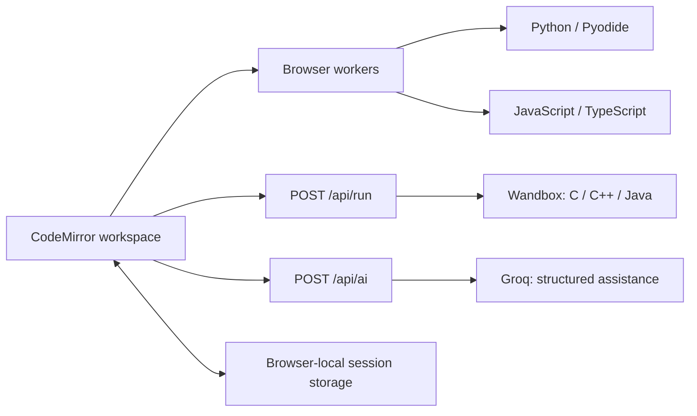

<div align="center">
  
  <h1>Spark Compiler</h1>
  <p><strong>A little code. A lot of possibility.</strong></p>
  <p>A no-login coding workspace with real execution, AI explanations, on-demand error help, and browser-local session memory.</p>
  <p><a href="https://spark-ai-compiler.vercel.app"><strong>Open the live app →</strong></a></p>
</div>

## What you can do

- **Use the whole screen:** work in a full-height editor, drag the divider to resize, collapse the tools panel, or expand either pane. Output, Input, AI, and History share tabs so each has room to breathe.
- **Write and run six languages:** Python, C, C++, Java, JavaScript, and TypeScript.
- **Learn while you code:** ask Spark to explain a line, walk through a program, or help build something new.
- **Get help with failed runs:** click **Help me fix this error** for an AI explanation and suggested correction, then choose whether to apply it.
- **Stay in control:** undo an AI change, review a suggested program before applying it, and stop a running task.
- **Work with real input:** supply standard input and inspect stdout, stderr, exit status, and execution time.
- **Keep your progress:** recover code and conversation after a refresh, restore earlier runs, and export or import a session as JSON.

No account is required. Running code does not require a Groq key; AI features do.

## Quick start

Use **Node.js 24** and npm, matching the deployed app and test environment.

```bash
git clone https://github.com/jitesh523/spark-compiler.git
cd spark-compiler
npm ci
cp .env.example .env.local
```

For server-configured AI, open `.env.local` in your editor and replace the placeholder:

```dotenv
GROQ_API_KEY=your_groq_key_here
```

Then start the app:

```bash
npm run dev
```

Open [localhost:3000](http://localhost:3000).

You can also leave the server key unset and use **Connect AI** inside the app with a personal key from [Groq Console](https://console.groq.com/keys). That key stays in memory for the visit and is sent to the server only for AI requests.

## Using the compiler

1. Choose a language and edit its source file.
2. Add any required values in the **Input** tab, one value per line.
3. Press **Run code**, or use **Cmd/Ctrl + Enter**.
4. Check **Output** for the program result or compiler diagnostics.
5. After a failed source run, click **Help me fix this error** in **Output**, or ask Spark a question in **AI**.
6. Review any suggested correction, click **Apply to editor** if you want it, then press **Run code** to test it.

Each language has its own source and input. Java programs should define a `Main` class. Use **File options** to download or copy source, **Run history** to restore previous code, and **Export session** to save a portable backup. **Cmd/Ctrl + S** saves the current session in the browser.

### How error help works

```text
Run code → inspect an error → click Help me fix this error
         → review the explanation and suggested correction
         → click Apply to editor → press Run code to test
```

Clicking **Help me fix this error** asks Groq to explain what happened and suggest a correction. Spark explains what changed and why it should work. The answer stays a suggestion until you explicitly click **Apply to editor**. Applying a suggestion saves an undo checkpoint so you can restore your previous code.

A failed run leaves the error in **Output** for you to inspect. AI help starts when you request it; code changes and reruns each require your action. After applying a correction, press **Run code** to test it. AI can make mistakes, so review both the explanation and actual output.

## Supported runtimes

| Language | Execution environment | Notes |
| --- | --- | --- |
| Python | Pyodide 0.29.2 in a browser Web Worker | Supports `input()` and `sys.stdin`; packages depend on the Pyodide distribution. |
| C | GCC 13.2 / C11 through Wandbox | Source and standard input are sent to the remote compiler. |
| C++ | GCC 13.2 / C++17 through Wandbox | Supports standard input and compiler diagnostics. |
| Java | OpenJDK 21 through Wandbox | Use a `Main` class with a standard `main` method. |
| JavaScript | Browser Web Worker | Supports console output, `stdin`, `readline()`, and `prompt()`; not a full Node.js environment. |
| TypeScript | TypeScript 5.9.3 transpilation, then a browser Web Worker | Syntax transpilation; no full semantic or multi-file typechecking. |

Browser executions start in a fresh worker, so program variables do not carry over between runs. Internet access is required for runtime downloads, AI, and remote compilation. This is a single-source-file playground per language, rather than a general-purpose package or project environment.

### Execution limits

| Limit | Current behavior |
| --- | --- |
| Browser execution | 10 seconds per run |
| Browser runtime startup | Up to 60 seconds, including runtime downloads |
| Remote compilation | 28-second upstream deadline; 30-second client wait |
| Captured output | 65,536 characters across stdout and stderr, plus diagnostic notices |
| Source sent to AI or the remote compiler | 30,000 characters |
| Standard input sent to AI or the remote compiler | 12,000 characters |
| AI provider request | 30-second deadline |

Stop terminates a browser worker or cancels the client request for remote work. External services also enforce their own availability and usage limits.

## Session memory and privacy

Spark keeps the workspace in this browser's `localStorage`:

| Saved data | Retention |
| --- | --- |
| Source and standard input | One file per supported language |
| Conversation and suggested source | Latest 200 messages, within a combined 160,000-character budget |
| Run history | Latest 40 runs |
| Undo checkpoints | Latest 30 checkpoints |

For an AI request, Spark supplies the current source, input, reported error, retained conversation, and the **latest eight run results**. Each previous stdout/stderr excerpt is limited to 2,000 characters. The current source is separate from the conversation budget.

Session memory is **browser-local**, with no account or cloud synchronization. Clearing browser data removes it. Export a session before switching browsers or starting a new session if you want to keep a backup.

Data goes to external services when those features are used:

- **Groq** receives the code and context needed for AI assistance.
- **Wandbox** receives C, C++, and Java source and standard input for compilation and execution.
- **Runtime CDNs** provide Pyodide and the TypeScript compiler for browser execution.

### API keys

- The repository includes only a placeholder in [`.env.example`](.env.example).
- Local `.env` files and `.vercel/` are excluded from Git.
- A server key is read from `GROQ_API_KEY`; it must **never** use a `NEXT_PUBLIC_` prefix.
- Personal connection keys are held in visit memory, not saved in session fields or session exports.
- AI credentials are not returned by the status endpoint or logged by the AI route.

Configure your own key locally or in your hosting provider. Do not put a real key in source, documentation, or a commit.

## Architecture



The UI uses **Next.js App Router, React, TypeScript, and CodeMirror**. AI assistance uses the **Vercel AI SDK**, the Groq provider, and Zod validation. Submitted programs are not executed as subprocesses on the Vercel application server.

```text
src/
├── app/
│   ├── api/ai/route.ts       # Groq assistance and structured responses
│   ├── api/run/route.ts      # Remote compiler proxy
│   ├── globals.css          # Responsive workspace styles
│   └── page.tsx             # App entry point
├── components/
│   ├── code-editor.tsx      # Language-aware editor
│   └── workspace.tsx        # Run, error help, chat, and history flows
└── lib/
    ├── ai-types.ts          # Shared AI request/response types
    ├── request-origin.ts    # Same-origin request validation
    ├── runtime.ts           # Execution orchestration and cancellation
    └── session.ts           # Session validation and persistence
public/runtime-worker.js     # Browser language runtimes
tests/                       # AI, origin validation, and session tests
```

The default AI model is `openai/gpt-oss-120b`, configured in `src/app/api/ai/route.ts`.

## Development and checks

| Command | Purpose |
| --- | --- |
| `npm run dev` | Start the development server |
| `npm run typecheck` | Check TypeScript types |
| `npm test` | Run automated tests |
| `npm run build` | Create a production build |
| `npm start` | Serve the production build locally |

The automated suite covers session round-trips, malformed imports, credential-field exclusion, storage failures, bounded history, AI request validation, mocked provider responses, rate limits, and origin checks. Tests do not require a real Groq key and do not replace live runtime checks.

## Deploy to Vercel

1. Import this GitHub repository into Vercel.
2. Select **Next.js** as the framework and keep the repository root as the project root.
3. Add `GROQ_API_KEY` as a **sensitive environment variable** for the intended environment. Leave it unset if each visitor should supply their own key.
4. Deploy. When adding or changing environment variables, redeploy to apply them.
5. Open the public production URL, test a normal run, then test **Help me fix this error**, **Apply to editor**, and a manual rerun.

The app has no login flow. To offer public access, the production domain must also permit anonymous visitors in your Vercel project settings.

API routes validate inputs and request origins, bound payload sizes, enforce deadlines, and apply per-instance rate limits. These supplement provider quotas; they are not a distributed quota system.
